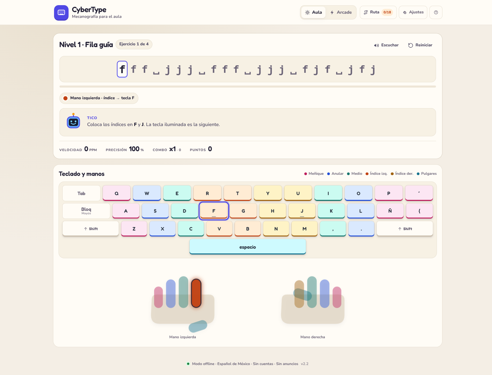
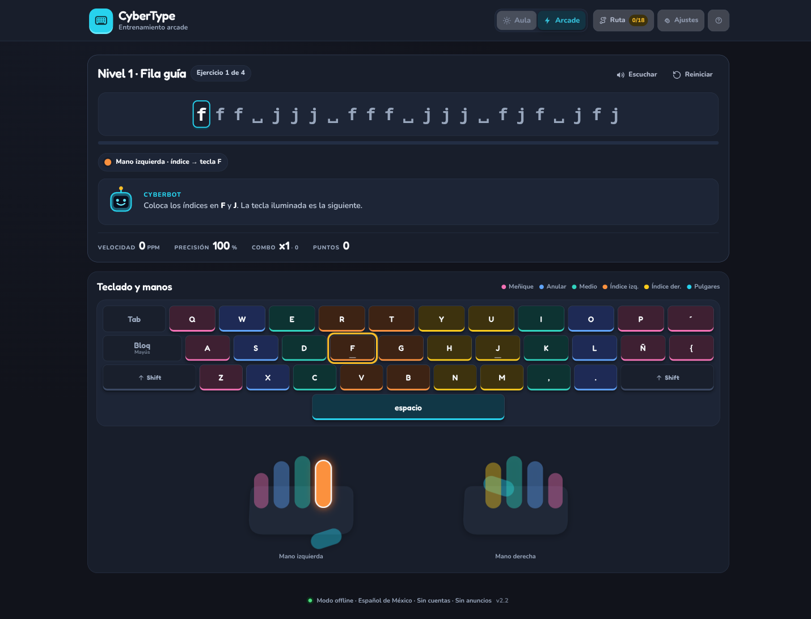
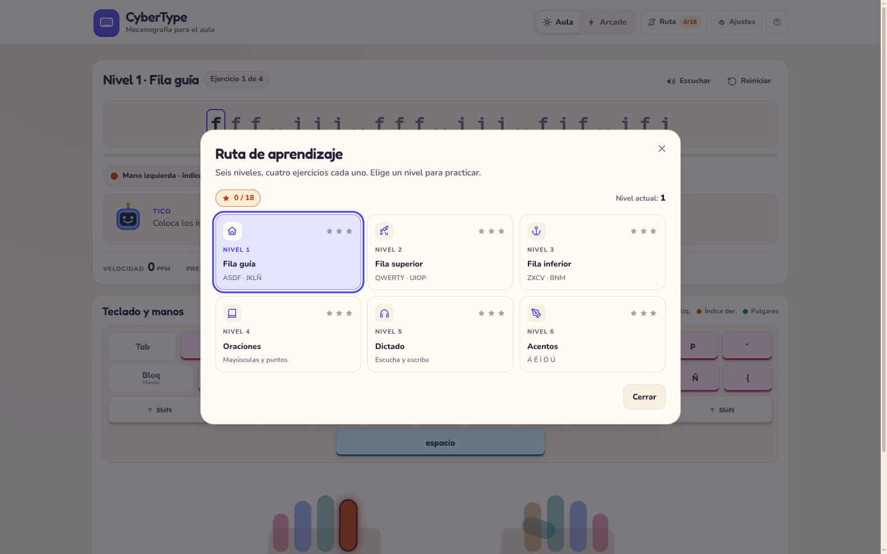
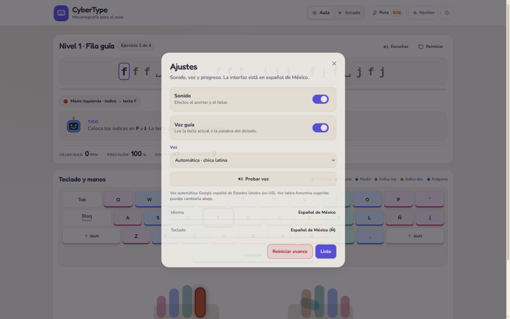
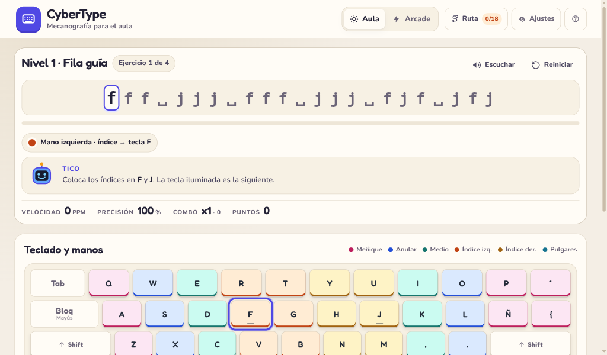

# CyberType

Entrenador de mecanografía offline **en español de México** para primaria y secundaria. Funciona en Windows, Linux y macOS, sin cuentas, sin anuncios, sin servidor y sin conexión a internet.



## Qué incluye

- **Dos modos:** Aula (claro, cálido) y Arcade (oscuro, de alto contraste).
- **Seis niveles, cuatro ejercicios cada uno:** fila guía, fila superior, fila inferior, oraciones, dictado y **acentos**.
- **Acentos reales:** nivel 6 con á, é, í, ó, ú. En el teclado físico se usan la tecla muerta `´` + vocal; en pantalla hay una tecla `´` que se activa y luego se elige la vocal.
- **Teclado virtual** con color por dedo, tecla objetivo iluminada y manos SVG rediseñadas con los dedos en orden y el dedo activo resaltado.
- **Ruta oculta:** la ruta de aprendizaje se abre como ventana desde el botón **Ruta** del header.
- **Ajustes en ventana:** sonido, voz, prueba de voz y reinicio de avance se abren desde el engranaje del header.
- **Voz latina priorizada:** el selector automático busca primero una voz latinoamericana femenina (es-MX, es-US, es-419 y otras variantes) y sube el tono para un timbre juvenil. Solo ofrece voces latinoamericanas; si el sistema no tiene ninguna, desactiva la voz guía y lo indica.
- **Progreso local:** estrellas, nivel, ejercicio, sonido, voz y voz seleccionada se guardan en `localStorage`.
- **Accesibilidad:** foco visible, diálogos nativos, `aria-live`, `aria-pressed`, objetivos táctiles de 44 px en móvil y `prefers-reduced-motion`.
- **Cero dependencias externas en runtime:** fuentes locales, iconos SVG y CSS propio.

| Aula | Arcade |
| --- | --- |
|  |  |

La ruta y los ajustes viven en ventanas que se abren desde el header:

| Ruta de aprendizaje | Ajustes |
| --- | --- |
|  |  |



## Cómo usarlo

### Opción 1: archivo portátil

Abre **`dist/CyberType.html`** con doble clic. Es un archivo autocontenido: incluye CSS, JavaScript, fuentes e iconos. No necesita internet, instalación ni servidor.

Puedes copiarlo a una USB, a una carpeta compartida o al escritorio de una netbook escolar. Funciona igual en Windows y Linux.

### Opción 2: carpeta completa + PWA

- **Windows:** doble clic en `start.bat`.
- **Linux/macOS:** ejecuta `./start.sh`.
- **Manual:** `python3 serve.py` y abre la URL que imprime (normalmente `http://127.0.0.1:8000/`).

El servidor solo escucha en `127.0.0.1` y no envía nada a internet. Si el puerto 8000 está ocupado, prueba el siguiente automáticamente.

### Opción 3: app de escritorio (Electron)

El wrapper está en `desktop/`. Usa el build portátil y abre una ventana nativa de Electron; sigue funcionando sin conexión.

```bash
cd desktop
npm install
npm start
```

Para generar binarios:

```bash
npm run pack:linux   # AppImage
npm run pack:win     # ejecutable portable de Windows
```

Los artefactos salen en `desktop/release/` y no se versionan por tamaño. El workflow **Desktop packages** los construye en GitHub Actions para Linux y Windows. La firma de código requiere configurar `CSC_LINK` y `CSC_KEY_PASSWORD` con un certificado propio; sin certificado, los binarios son funcionales pero no están firmados.

## Desarrollo

No hay framework ni bundler para la app web. El código fuente es HTML, CSS y JavaScript vanilla.

```bash
# Servir en local
npm run serve          # o python3 serve.py

# Generar el archivo portátil autocontenido
npm run build          # o python3 build.py

# Comprobaciones objetivas
python3 tests/check_offline.py
python3 tests/check_contrast.py

# Tests de navegador
npm test               # requiere npx playwright install chromium
```

Flujo recomendado:

1. Edita `index.html`, `assets/css/app.css` o `assets/js/app.js`.
2. Prueba con `npm run serve`.
3. Ejecuta `npm run build` para actualizar `dist/CyberType.html`.
4. Ejecuta las comprobaciones y `npm test`.
5. Si cambias assets cacheados por el service worker, sube `CACHE_NAME` en `sw.js`.

### Estructura

```text
.
├── index.html                    # App fuente
├── assets/
│   ├── css/app.css               # Tokens, componentes y temas
│   ├── js/app.js                 # Lógica, voz, acentos y persistencia
│   ├── fonts/                    # Fredoka y Nunito (WOFF2 + OFL)
│   └── icons/                    # Icono SVG + PNG para PWA
├── dist/CyberType.html           # Build portátil de un solo archivo
├── desktop/                      # Wrapper Electron + build AppImage/Windows
├── design-system/cybertype/      # Sistema de diseño + brief de práctica
├── docs/                         # Capturas de referencia
├── legacy/                       # Implementación original conservada
├── tests/
│   ├── e2e/app.spec.js           # Playwright
│   ├── check_offline.py
│   ├── check_contrast.py
│   └── README.md                 # Matriz manual
├── .github/workflows/            # CI web + paquetes de escritorio
├── package.json                  # Scripts y Playwright
├── playwright.config.js
├── build.py                      # Genera dist/CyberType.html
├── serve.py                      # Servidor local opcional
├── start.sh / start.bat          # Lanzadores
├── manifest.webmanifest          # PWA
├── sw.js                         # Cache offline
├── PRODUCT.md                    # Verdad de producto
├── DESIGN.md                     # Decisiones visuales y de interacción
└── README.md
```

## Pruebas

Automáticas:

- `python3 tests/check_offline.py`: no hay CDN, fuentes remotas ni rutas rotas; el build no depende de `assets/`.
- `python3 tests/check_contrast.py`: texto, botones, teclas, badges y estados en Aula y Arcade.
- `npm test`: 9 pruebas Playwright de carga, ejercicio completo, ruta, ajustes, acentos, migración, corrupción de datos, reduced motion y build de un solo archivo.
- `.github/workflows/ci.yml`: ejecuta todo en cada push y pull request.

La matriz manual completa está en [`tests/README.md`](tests/README.md).

## Privacidad

- No hay backend, cuentas, cookies de seguimiento ni analítica.
- El progreso vive en `localStorage` de este navegador o en el perfil de Electron.
- La voz se sintetiza con el motor del sistema; el texto no sale del equipo.
- El único servidor es opcional, local y de solo lectura.

## Compatibilidad

- Chrome/Edge 100+, Firefox 100+, Safari 15.4+.
- Se usa `<dialog>` nativo, `:focus-visible`, `color-scheme` y `gap` en flex.
- El objetivo principal es escritorio; la interfaz se adapta hasta 360 px, pero la experiencia está pensada para teclado físico y pantallas de 1024×600 o más.
- La voz depende de las voces instaladas en el sistema operativo; la app prioriza una voz latinoamericana femenina y avisa si no existe.

## Decisiones de diseño

- **Un solo escenario:** la práctica y el teclado ocupan el ancho principal; no hay tarjetas laterales que compitan con la tarea.
- **Ruta y ajustes bajo demanda:** son ventanas nativas disparadas desde el header, no paneles permanentes.
- **Manos como guía:** dedos ordenados de meñique a índice, pulgar en el lado interno y dedo activo con trazo y brillo.
- **Acento explícito:** la tecla muerta `´` se resalta cuando la siguiente letra requiere tilde; en pantalla se activa y luego se elige la vocal.
- **Voz con criterio:** se prioriza una voz latina femenina por metadatos del sistema; el docente puede elegir otra voz latinoamericana y probarla. Si no hay voces latinas, la voz guía se desactiva.
- **Offline primero:** el build de un solo archivo no hace ninguna petición de red y el service worker cachea la versión servida.

## Limitaciones y siguientes pasos

- **Firma de binarios:** el pipeline está listo para `CSC_LINK`/`CSC_KEY_PASSWORD`, pero no se incluye un certificado.
- **Perfiles:** el progreso es por navegador/perfil de Electron, no por estudiante. Un aula compartida necesita reinicio o perfiles locales.
- **Docente:** no hay panel ni exportación de resultados. Un CSV/JSON de sesión sería el siguiente incremento.
- **Analítica didáctica:** se pueden añadir errores por tecla, tiempo por lección y recomendaciones de práctica.
- **Contenido:** ampliar el corpus por nivel y añadir más frases contextualizadas.
- **Voces:** la detección de género es heurística por nombre; no todos los sistemas exponen esa información.

## Créditos y licencia

- Código y diseño: proyecto CyberType.
- Tipografías: **Fredoka** y **Nunito**, SIL Open Font License 1.1. Las licencias están en `assets/fonts/`.
- Iconos: SVG de 24 px dibujados para este proyecto, con convenciones de trazo inspiradas en Lucide (ISC). Ver [`THIRD_PARTY.md`](THIRD_PARTY.md).
- La implementación original de TeclaMágica se conserva en `legacy/teclamagica-original.html` como referencia.
- Licencia del proyecto: MIT. Ver [`LICENSE`](LICENSE).
